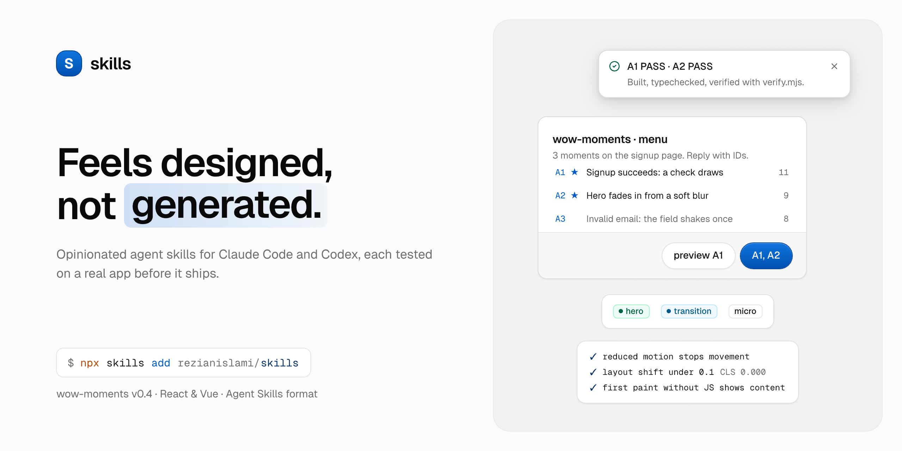
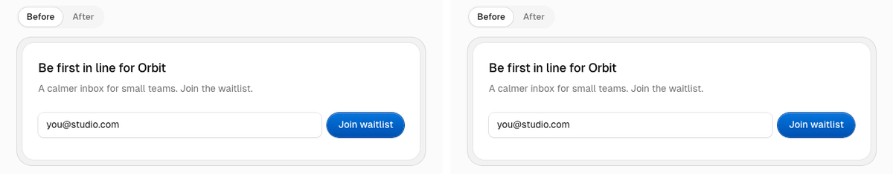

<!-- Banner images live in .github/assets. The banner is the canvas frame
     "skills / README banner" (Light/Dark) in component-v1-2026.pen, next to
     the Rezi UI one, and names the wow-moments version, so re-export it when
     that changes. -->
<picture>
  <source media="(prefers-color-scheme: dark)" srcset=".github/assets/banner-dark.png">
  
</picture>

<p align="center">
  <a href="#install">Install</a>
  ·
  <a href="#skills">Skills</a>
  ·
  <a href="#faq">FAQ</a>
  ·
  <a href="#development">Development</a>
  ·
  <a href="CONTRIBUTING.md">Contributing</a>
</p>

<p align="center">
  <a href="https://github.com/rezianislami/skills/actions/workflows/check.yml"></a>
  <a href="skills/wow-moments"></a>
  <a href="https://agentskills.io/specification"></a>
  <a href="LICENSE"></a>
</p>

# skills

**Agent skills for interfaces that feel designed, not generated.**

<p align="center">
  
</p>

Built for Claude Code, Codex and any agent that reads the open [Agent Skills](https://agentskills.io/specification) format. Each skill is opinionated, small enough to read in one sitting, and tested on a real app before it ships.

## Install

```bash
# pick from the list
npx skills add rezianislami/skills

# or just one
npx skills add rezianislami/skills --skill wow-moments
```

No CLI? Copy a folder from [`skills/`](skills) into your agent's skills folder:

| Agent | This project | Every project |
|---|---|---|
| Claude Code | `.claude/skills/<name>/` | `~/.claude/skills/<name>/` |
| Codex | `.agents/skills/<name>/` | `~/.agents/skills/<name>/` |

## Skills

### [wow-moments](skills/wow-moments)

> Your UI works. Now find the three moments worth animating, not the thirty.

Scans a built React / Next.js or Vue / Nuxt frontend, hand-written or vibe-coded, for the moments that *mean* something: a first success, an empty list getting its first item, results arriving, a theme switch. It also finds non-motion wins (a write that answers instantly, undo instead of "Are you sure?", keyboard shortcuts) and generic animations worth quieting down. It ranks them, caps them per screen, and hands you a menu. You pick, it gives a verdict and a storyboard (a live preview if you ask), and after you confirm it builds only those, with reduced-motion, no-JS, accessibility and failure-path guardrails, and reports PASS/FAIL per moment.

```text
You:    The page is done. Find wow moments in it.

Agent:  A1 ★  Signup succeeds: a check mark draws, the confirmation settles in place    hero        11
        A2 ★  Hero entrance: headline, subline, form fade in from a slight blur          transition   9
        A3    Invalid email: the input shakes once, the error changes in place           micro        8
        …     Reply with IDs.

You:    A1, A2

Agent:  A1 GO · A2 GO, with a note (second motion on the same form; keep it short)
        storyboards for both … reply `go`, or `preview A1`

You:    go

Agent:  builds both, typechecks, builds, runs verify.mjs → A1 PASS · A2 PASS
```

The menu is abridged from a real run on the [`landing-page`](examples/wow-moments/landing-page) fixture; the verdict and PASS lines show the v0.4 flow. The GIF above shows the same two moments built on a [Rezi UI](https://reziui.rezianislami.workers.dev) signup form, recorded from the live demo on [portfolio.rezianislami.workers.dev/skills](https://portfolio.rezianislami.workers.dev/skills/).

15 worked patterns · React and Vue · remembers your motion language between runs · a guardrail checker · evaluated end to end with a real agent

**[Read the full wow-moments guide →](skills/wow-moments)**

## FAQ

**Will it change my code without asking?**
No. The scan ends with a menu and the agent stops there. Nothing is edited until you reply with the IDs you want, and then only the files those moments need.

**Will it add dependencies?**
Not without asking. It uses what your project already has: plain CSS, Tailwind, Motion, Vue's `<Transition>`, or View Transitions.

**Which frameworks does it support?**
React / Next.js (App Router and Pages Router) and Vue / Nuxt. The patterns' reasoning and CSS are framework-agnostic; the component code is written for React, with Vue versions in [`implementation-vue.md`](skills/wow-moments/references/implementation-vue.md).

**Which agents?**
Any agent that loads Agent Skills. It's developed and evaluated with Claude Code; Codex reads the same format from `.agents/skills/`.

**How much does a run cost?**
It depends on the size of the app and the model. On the `landing-page` fixture with Claude Code, a scan used about $0.60 of tokens, and a scan plus building two moments about $1.90.

**How is this different from a motion audit?**
An audit polishes the motion you already have, component by component. wow-moments looks for the places that deserve motion and don't have it yet, judged by what the moment means to the user, and deliberately proposes only a few.

**Does it remember my choices?**
Yes. A small `.wow-moments.md` in your project records the motion language, what was built and what you declined, so the next run stays consistent and doesn't pitch rejected ideas again. Delete the file to start fresh.

## Repository layout

```
skills/<name>/      the skill itself: SKILL.md, references/, README.md, CHANGELOG.md
examples/<name>/    test fixtures (not installed with the skill)
evals/<name>/       end-to-end agent evals (run by hand, cost tokens)
tools/              CI checks: skill format, links, typechecked code blocks, browser tests for skill scripts
assets/             the demo GIF
.github/assets/     README banners
```

## Development

Every check that CI runs works locally. From the repo root:

```bash
cd tools && npm ci                   # once
npx playwright install chromium      # once, for the verify.mjs tests

node check-skills.mjs                # frontmatter (Agent Skills spec) and relative links in skills/
node check-snippets.mjs              # typecheck every ```tsx / ```ts / ```vue block in every skill
npm test                             # run verify.mjs in a real browser against known-bad pages
```

The agent eval is separate. It starts a real headless Claude Code session on a copy of a fixture, so it costs tokens and is run by hand before a release:

```bash
node evals/wow-moments/run.mjs landing-page                       # scan only, about $0.60
node evals/wow-moments/run.mjs sample-next-app --pick "A1, A2"    # scan, verdict and build, about $3.80
```

Gotchas:

- **`check-skills.mjs` only checks links inside `skills/`.** Links in this README and in `CONTRIBUTING.md` aren't checked, so click through them after editing.
- **Fixtures must stay motion-free.** CI fails if `landing-page` or `sample-next-app` gain an `@keyframes`, `animation` or `transition`. `landing-page-after` is exempt, since it's the result of a run.
- **`sample-next-app/README.md` lists the expected answers.** Copy the app elsewhere without it before testing a scan by hand, or the agent reads the answers.
- **The eval needs the `claude` CLI, logged in.** Add `--keep` to keep the temporary copy for inspection.

Adding a skill or a pattern: see [CONTRIBUTING.md](CONTRIBUTING.md). Release notes: [wow-moments changelog](skills/wow-moments/CHANGELOG.md).

## Roadmap

- [ ] A Nuxt fixture, so the Vue patterns are evaluated end to end with SSR, like the React ones
- [ ] A fixture with interaction opportunities (a confirm-to-delete, a slow toggle, filters that reset), so the interaction tier is evaluated end to end
- [ ] Svelte / SvelteKit implementation guide
- [ ] Public release on [skills.sh](https://skills.sh)
- [ ] More skills in this collection

## Contributors

Built by [Rezian Al Islami](https://github.com/rezianislami), with [Claude Code](https://claude.ai/claude-code).

Found a moment type the skill misses, a pattern that breaks in your stack, or a bug? Open an [issue](https://github.com/rezianislami/skills/issues).

<!-- When the repo is public, add the contributor grid:
<a href="https://github.com/rezianislami/skills/graphs/contributors"></a>
-->

## License

[MIT](LICENSE)
