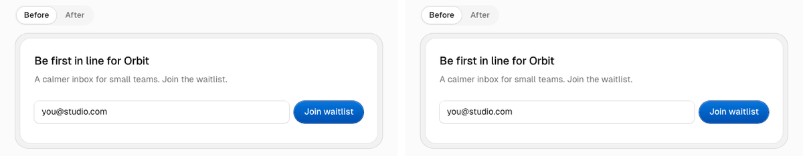

# wow-moments

**Your UI works. Now find the three moments worth animating, not the thirty.**

<p>
  
  
  
  
</p>

[How it works](#how-it-works) · [Patterns](#patterns-included) · [What's inside](#whats-inside) · [Install](#install) · [Run memory](#run-memory) · [Verify](#verify-a-moment) · [Troubleshooting](#troubleshooting) · [Changelog](CHANGELOG.md)

<p align="center">
  
</p>

Most AI-built interfaces animate everything: every section fades up, every card lifts, every number scrambles. That's exactly what makes them look generated. This skill works the other way round. It reads your product's flows, finds the moments that *mean* something, ranks them, caps them per screen, and asks you before touching a line of code.

"Three" is a rule of thumb, not a hard limit. The skill scans every screen in your repo, and every candidate cites a real `file:line`. Per screen, it recommends at most one hero, three transition or micro moments and two interaction moments. An app with five screens can get far more than three, and a settings page can rightly get none.

```bash
npx skills add rezianislami/skills --skill wow-moments
```

## How it works

```
 1. Intake    reads .wow-moments.md, package.json and the motion you already have;
      │       asks at most two questions
      │
 2. Scan      every screen → its state changes and friction → 11 motion + 6 interaction
      │       moment types → scored and budgeted; generic motion noted for quiet-down
      │
 3. Menu ⛔   ranked candidates with file:line, trigger, technique, reduced-motion or
      │       failure behaviour, plus up to 5 existing animations to quiet down
      │       … then it stops. Nothing changes until you pick.
      │
 4. Verdict ⛔ GO / GO with a note / SWAP per pick, judged as a set, with a storyboard;
      │       `preview A1` writes a throwaway HTML preview. Stops until you say go.
      │
 5. Build     only what you confirmed, lightest technique first; then typecheck, build,
              verify.mjs, failure-path tests, a PASS / FAIL / NOT VERIFIED verdict,
              and .wow-moments.md
```

## What makes it different

| | |
|---|---|
| **Moment-first** | It looks for state changes users care about (first success, empty → filled, results arriving), not dropdowns to polish. |
| **A budget, not a buffet** | Per screen, at most one hero, three transition or micro moments and two interaction moments get recommended (★). Everything else it found is still listed under "Considered, not recommended" with the reason, so nothing is hidden. "Nothing here" is a valid answer. |
| **Not only motion** | Some of the best moments are behaviour: a checkbox that saves instantly and rolls back on failure, undo instead of "Are you sure?", `/` to search, filters that survive a reload. |
| **Quiet down** | Vibe-coded apps often animate everything. The menu can list up to five existing animations that compete with your best moment, and removes them only if you pick them. |
| **You choose, then it tells you what it thinks** | The scan ends with a menu. Your picks get a verdict and a storyboard, and a live HTML preview on request, before a line of code changes. |
| **Built properly** | Reduced-motion path, correct first paint without JavaScript, no layout shift, screen-reader-safe, touch-aware, and comments that explain *why*. |
| **Remembers** | A small `.wow-moments.md` in your repo records the motion language, what was built and what you declined. The next run matches the signature and doesn't pitch rejected ideas again. |
| **React and Vue** | React / Next.js and Vue / Nuxt, with the Vue versions of the patterns checked in a real browser. |
| **Uses what you have** | Plain CSS, Tailwind, Motion (`motion` / `framer-motion`) or View Transitions, whichever your project already uses. No surprise dependencies. |

## A real menu

Abridged, from a run on the [`landing-page`](../../examples/wow-moments/landing-page) fixture:

| ID | Moment | Tier | Score | Effort |
|---|---|---|---|---|
| A1 ★ | Signup succeeds: a check mark draws and the confirmation settles in place | hero | 11 | S |
| A2 ★ | Hero entrance: headline, subline, form fade in from a slight blur on first paint | transition | 9 | S |
| A3 | Invalid email: the input shakes once and the error changes in place | micro | 8 | S |

Picking `A1, A2` produced [`landing-page-after`](../../examples/wow-moments/landing-page-after). The GIF above shows the same two moments on a [Rezi UI](https://reziui.rezianislami.workers.dev) signup form.

## Patterns included

| Pattern | Moment |
|---|---|
| Scroll reveal | Sections unfold on first paint or first scroll into view |
| Theme sweep | Theme switch spreads as a soft circle from the toggle |
| Count-up | Key numbers count up once when first seen |
| Cursor preview | Hovered list row shows a trailing image |
| Sliding indicator | Tabs or segmented control with one sliding pill |
| Rolling text | Text that changes in place rolls like an odometer |
| Success check | Confirmation takes the form's place, check draws, focus follows |
| Error feedback | Field shakes once, error grows in place |
| List enter | New item arrives, the rows below glide down |
| Skeleton reveal | Results replace a skeleton in the same box |
| Streaming answer | AI answer streams: real step status, stick-to-bottom, quiet finish |
| Route transition | List → detail: the clicked item travels, the page slides by direction |
| Optimistic update | A write shows at once, rolls back to the confirmed value on failure |
| Undo instead of confirm | Delete with an undo toast; deferred commit, nothing lost |
| Keyboard shortcut | `/` to search, `Ctrl/⌘+Enter` to send; never while typing, can be turned off |

Every pattern explains *why* it's built that way, and its code is typechecked in CI.

## What's inside

`SKILL.md` is what the agent reads first: the five phases and when to open each reference. The references load only when a phase needs them, so a scan doesn't pay for the build instructions.

```
skills/wow-moments/
├── SKILL.md            the workflow the agent follows
├── README.md           this page
├── CHANGELOG.md
├── references/         loaded on demand, one topic per file
└── scripts/verify.mjs  guardrail checker, run in Phase 5
```

**Scan and menu**

| File | What it decides |
|---|---|
| [moment-taxonomy.md](references/moment-taxonomy.md) | What to look for: each moment type, the code signals that reveal it, its usual tier and the trap to avoid |
| [scoring.md](references/scoring.md) | The rubric that ranks candidates, so you can see why one idea beat another |
| [budget.md](references/budget.md) | Per-screen caps and the one-signature-per-app rule |
| [anti-slop.md](references/anti-slop.md) | Patterns that make an interface look generated, never proposed |
| [candidate-format.md](references/candidate-format.md) | The menu layout: where, trigger, technique, cost |

**Verdict and build**

| File | What it decides |
|---|---|
| [verdict-and-preview.md](references/verdict-and-preview.md) | GO / GO with a note / SWAP, storyboards, the HTML preview and the final PASS / FAIL / NOT VERIFIED labels |
| [motion-scale.md](references/motion-scale.md) | Default durations and easings, used only when the project has none of its own |
| [implementation-react.md](references/implementation-react.md) | Which technique to reach for in React / Next.js, lightest first |
| [implementation-vue.md](references/implementation-vue.md) | The Vue 3 / Nuxt shape of the same patterns |
| [guardrails.md](references/guardrails.md) | The checks every built moment must pass |
| [run-memory.md](references/run-memory.md) | The `.wow-moments.md` format and when it's read and written |

**Patterns:** one `pattern-*.md` per row in [Patterns included](#patterns-included), each with the moment, why it's built that way, typechecked code and its reduced-motion path.

## Requirements

- A frontend that already works: React / Next.js (App Router or Pages Router) or Vue / Nuxt.
- An agent that loads [Agent Skills](https://agentskills.io/specification): developed and evaluated with Claude Code; Codex reads the same format.
- Optional, for `verify.mjs`: Playwright in your project or installed globally, plus Playwright's Chromium or an installed Google Chrome. Without them the build still runs and the verdict says NOT VERIFIED instead of PASS.

## Install

```bash
npx skills add rezianislami/skills --skill wow-moments
```

Or copy this folder into your agent's skills folder:

| Agent | Project | Personal |
|---|---|---|
| Claude Code | `.claude/skills/wow-moments/` | `~/.claude/skills/wow-moments/` |
| Codex | `.agents/skills/wow-moments/` | `~/.agents/skills/wow-moments/` |

Works with **React / Next.js** (App Router and Pages Router) and **Vue / Nuxt**. Then, once your UI is built, ask:

> The UI is done. Find wow moments in it.

Other phrasings that trigger it: "add delight", "where should we animate", "add micro-interactions", "make this app feel better".

## Run memory

After a build, the skill writes `.wow-moments.md` to your project root. Commit it, so everyone (and every agent) working on the app shares the same motion language:

```markdown
# Wow moments

## Motion language
- Easing: standard-out cubic-bezier(0.2, 0, 0, 1); long-out cubic-bezier(0.16, 1, 0.3, 1)
- Durations: micro 150ms · transition 250ms · hero 600ms
- Signature: soft blur-in (8px rise, 4px blur), used for the landing hero only

## Built
- 2026-11-02 · Signup success: check draws, confirmation takes the form's place (`components/signup.tsx`)

## Quieted
- 2026-11-04 · Hover lift on project cards removed, colour change kept (`components/project-card.tsx`)

## Declined
- 2026-11-02 · Monthly/yearly price roll: "price is read once, not worth it"
```

The next run reads it first: its motion language overrides the skill's defaults, and nothing under *Declined* is pitched again unless the code it depended on has changed. Edit it by hand if you like; delete it to start fresh. It never holds secrets or user data. Full format in [run-memory.md](references/run-memory.md).

## Verify a moment

The skill runs this itself in Phase 5, but you can run it too, against any running page:

```bash
node skills/wow-moments/scripts/verify.mjs http://localhost:3000/ \
  --fill "input[type=email]=me@example.com" --click "form button"
```

```
✓ first paint without JS shows content
✓ reduced motion stops movement
✓ layout shift (CLS) under 0.1  (CLS 0.000)
✓ no transform/filter traps fixed elements
```

It needs Playwright in your project (or globally), and falls back to an installed Chrome if Playwright's browser isn't downloaded. It never installs anything itself.

| Flag | Does |
|---|---|
| `--fill "<selector>=<text>"` | Types into a field first. Splits on the last `=`, so `input[type=email]=…` works |
| `--click "<selector>"` | Clicks to trigger the moment, after `--fill` |

Exit codes: `0` all checks passed · `1` a check failed · `2` bad usage · `3` no Playwright or no browser.

## Troubleshooting

**The skill doesn't start.** Ask in the words it listens for ("find wow moments in this app"), or check the folder is where your agent looks (see [Install](#install)). Agents load a skill by its `description`, so a vague request like "improve the UI" may go elsewhere.

**The menu says there's nothing worth animating.** That's a valid answer, not a failure: the budget prefers no moment to a weak one. The menu still lists what it rejected and why.

**The verdict is NOT VERIFIED.** The build passed but `verify.mjs` couldn't run, usually because Playwright or a browser is missing. Install them (`npm i -D playwright && npx playwright install chromium`) and run the check above, or check the listed points by hand in DevTools. It isn't a pass.

**`verify.mjs` exits with 3.** Same cause: no Playwright in the project or globally, or no Chromium and no Google Chrome.

**It pitches something you already declined.** It only re-proposes a declined idea when the code it depended on has changed. If that's not the case, check the line is under *Declined* in `.wow-moments.md`.

**It picked the wrong easing or durations.** Your project's own motion code wins, then `.wow-moments.md`, then the skill's defaults. Edit the *Motion language* section to set them.

## How it's tested

- **Every push (CI):** frontmatter and links validated, every code block in the skill typechecked (React with `tsc`, Vue with `vue-tsc`), every fixture built, and the motion-free fixtures checked to still be motion-free.
- **Before a release:** [`evals/wow-moments/run.mjs`](../../evals/wow-moments/run.mjs) runs a real headless Claude Code session on a fixture and checks that the skill triggers on its own, stops at the menu, changes nothing before you pick, keeps to the budget, cites real `file:line`s, and that the picked moments build with reduced motion handled and no new dependencies.

## Try it on a fixture

Motion-free fixtures live in [`examples/wow-moments`](../../examples/wow-moments):

- `landing-page`: a one-page marketing site.
- `sample-next-app`: a small app with an empty state, a long-running job, tabs and a theme toggle. Its README lists what a good scan should find, so copy the app elsewhere without that README before you test.

```bash
cd examples/wow-moments/landing-page
npm install && npm run dev
```

## Changelog

See [CHANGELOG.md](CHANGELOG.md). The current version is in `metadata.version` in [SKILL.md](SKILL.md).

## License

[MIT](../../LICENSE)
